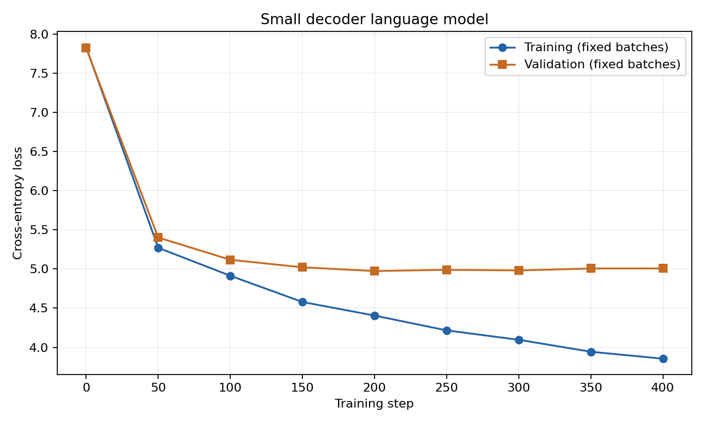
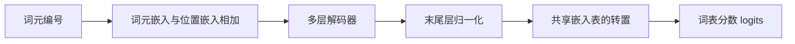

# 基于解码器的语言模型

一个用于理解下词预测和因果注意力的 NLP 编程项目。使用 PyTorch 基础张量运算实现线性映射、嵌入查表、层归一化、多头注意力和前馈网络，再组合成解码器语言模型。

项目包含课程题目、完整实现、实验报告和一次实际运行的记录。四层小模型用于训练与调试；约 300M 模型只做参数统计和推理演示。

- [题目原文](docs/assignment.pdf) · [题目整理](docs/assignment.md)
- [实验报告 PDF](docs/experiment_report.pdf) · [可编辑 Word 版](docs/experiment_report.docx)
- [训练结果与文件说明](results/README.md) · [数据来源](data/README.md)

## 已完成的结果

| 项目 | 结果 |
| --- | ---: |
| 单词级词表大小 | 2510 |
| 小模型参数量 | 1,122,816 |
| 小模型训练步数 | 400 |
| 固定批次训练损失 | 7.8334 → 3.8541 |
| 固定批次验证损失 | 7.8236 → 5.0068 |
| 大模型参数量 | 305,012,736 |
| 核心检查 | 10 项通过 |



损失在固定评估批次上计算，验证集没有逐项完整遍历。验证损失在约 200 步后趋于平稳并略有回升，因此本次没有继续增加训练步数。

## 快速运行

已验证环境为 **Windows、Python 3.12.9、PyTorch 2.5.1+cpu**。默认使用 CPU，不需要显卡。以下命令都在项目根目录执行。

### 1 创建环境并安装依赖

Windows PowerShell：

```powershell
py -3.12 -m venv .venv
.\.venv\Scripts\python.exe -m pip install -r requirements.txt
```

后续命令中的 `.\.venv\Scripts\python.exe` 均为刚创建环境内的 Python。需要安装本次记录的完整依赖版本时，可用 `requirements-lock.txt` 替代 `requirements.txt`。依赖文件配置的是 CPU 版 PyTorch 下载源。

### 2 检查实现是否正常

```powershell
.\.venv\Scripts\python.exe checks.py
```

检查包括数值计算、因果掩码、完整模型因果性、标签错位、梯度、参数量、保存加载、分词及微型样本拟合。新结果写入 `runs/checks.json`。

### 3 直接使用附带的小模型续写

```powershell
.\.venv\Scripts\python.exe generate.py --checkpoint results/small/checkpoint.pt --prompt "alice was" --new-tokens 40 --temperature 0.8 --top-k 30 --seed 42
```

仓库附带约 4.5 MB 的小模型检查点，配置和词表也保存在其中，因此不需要先训练。上述设置对应的已记录输出为：

```text
alice was going to the caterpillar; and she was as she had got to find her as she had kept on the mouse to work up: she could not try the table and she had been in their arm:
```

只训练了较少步数，句子可能重复或不通顺。将 `--temperature` 设为 `0` 可以使用贪心生成。

### 4 统计约 300M 模型参数并做推理

```powershell
.\.venv\Scripts\python.exe count_params.py --size 300m --tokenizer results/small/tokenizer.json --output runs/parameter_counts.json
.\.venv\Scripts\python.exe demo_large.py --tokenizer results/small/tokenizer.json --new-tokens 8 --output runs/large_demo.json
```

参数统计使用 meta 张量，只创建形状。推理脚本会实际分配完整的 float32 权重：仅权重约占 **1164 MiB**，还需预留运行时内存。

大模型使用随机初始化权重，没有训练；它的生成只用于展示推理流程，输出不代表训练效果。仓库没有保存约 300M 模型的权重文件，运行脚本时会根据固定种子重新初始化。

## 重新训练小模型

仓库已经包含处理好的文本，可以直接离线训练：

```powershell
.\.venv\Scripts\python.exe train.py --data data/alice.txt --steps 400 --output runs/my_run
.\.venv\Scripts\python.exe plot_loss.py --log runs/my_run/loss.csv --output runs/my_run/loss.png
.\.venv\Scripts\python.exe generate.py --checkpoint runs/my_run/checkpoint.pt --prompt "the rabbit" --new-tokens 40
```

输出目录非空时，训练程序会拒绝覆盖。重复实验请更换 `--output`。新的检查点、配置、词表、损失和样例保存在该目录内。

若要重新提取已附带的原始文本：

```powershell
.\.venv\Scripts\python.exe prepare_data.py --source-file data/alice_original.txt --source-url https://raw.githubusercontent.com/GITenberg/Alice-s-Adventures-in-Wonderland_11/master/11-0.txt --directory runs/rebuilt_data
```

不传 `--source-file` 时会联网下载，主站失败后尝试同一本书的镜像。镜像和原文版本可能变化，复现已记录结果时使用仓库附带的数据。

## 模型如何工作



每层解码器执行两次残差相加：先对归一化后的输入计算因果多头注意力，再对归一化后的中间状态计算前馈网络。注意力中手动拆分 Q/K/V，遮住未来位置，计算 softmax 后加权汇总 V，最后合并各个头。

输入和标签错开一位。例如输入 `alice was beginning`，标签为 `was beginning to`。模型对每个位置输出整个词表的分数，用交叉熵训练下一个词元的预测。

核心实现没有调用 `nn.Linear`、`nn.Embedding`、`nn.LayerNorm`、`nn.MultiheadAttention`、Transformer 模块或封装好的注意力计算接口。PyTorch 提供参数管理、张量计算、自动求导和 AdamW 优化器；`checks.py` 中的参考接口仅用来核对结果。

| 配置 | 小模型 | 约 300M 模型 |
| --- | ---: | ---: |
| 解码器层数 L | 4 | 24 |
| 隐藏维度 D | 128 | 1024 |
| 注意力头数 | 4 | 16 |
| 前馈维度 F | 512 | 4096 |
| 上下文长度 T | 64 | 128 |
| 词表大小 V | 2510 | 2510 |

两种配置都使用可学习位置嵌入，输入词元嵌入与输出映射共享参数。总参数量为：

```text
(V + T) * D + L * (4 * D * D + 2 * D * F + 9 * D + F) + 2 * D
```

## 代码从哪里开始读

建议按 `config.py → layers.py → model.py → data.py → train.py → generate.py` 的顺序阅读。

| 文件 | 作用 |
| --- | --- |
| `config.py` | 配置数据类与两种模型尺寸 |
| `layers.py` | 线性映射、嵌入、归一化、softmax、注意力和前馈 |
| `model.py` | 解码器层、完整语言模型和交叉熵 |
| `data.py` | 单词分词、词表、数据划分和连续窗口采样 |
| `prepare_data.py` | 下载或读取原文，提取小说正文 |
| `train.py` | 小模型训练、评估、检查点和日志保存 |
| `generate.py` | 加载检查点并逐词元生成 |
| `count_params.py` | 按张量统计参数，与公式核对 |
| `demo_large.py` | 随机初始化约 300M 模型并执行真实推理 |
| `checks.py` | 核心数值与训练流程检查 |
| `plot_loss.py` | 从实际 CSV 日志绘制损失曲线 |

## 目录说明

```text
nlp-decoder-lm/
├── README.md
├── requirements.txt
├── requirements-lock.txt
├── *.py
├── docs/
│   ├── assignment.pdf           # 原始课程题目
│   ├── assignment.md            # 题目要求整理
│   ├── experiment_report.pdf    # 实验报告预览
│   └── experiment_report.docx   # 可编辑报告
├── data/                        # 原文、处理后的语料和来源
└── results/                     # 已完成实验的固定记录
    ├── small/                   # 小模型权重、词表、曲线和生成样例
    ├── checks.json
    ├── parameter_counts.json
    └── large_demo.json
```

`results/` 是随仓库保留的参考结果；运行程序新生成的文件默认进入 `runs/`，后者已加入 `.gitignore`。虚拟环境、缓存和临时目录不属于仓库内容。

报告和历史训练记录中的本机路径属于当时的实验环境；在其他电脑上按上面的相对路径命令运行即可。不同硬件或依赖版本可能产生数值差异。

## 当前范围

- 使用英文单词级分词，没有实现 BPE。
- 小模型只训练到损失明显下降，不追求高质量生成。
- 约 300M 模型只统计参数并演示推理。
- 生成时重算最近的上下文，没有实现 KV cache。
- 检查点保存模型、配置和词表，没有保存优化器状态，不能精确续接中断训练。
